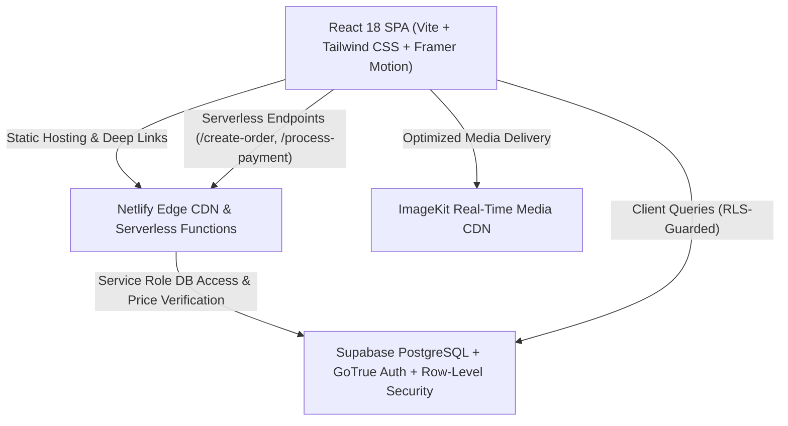
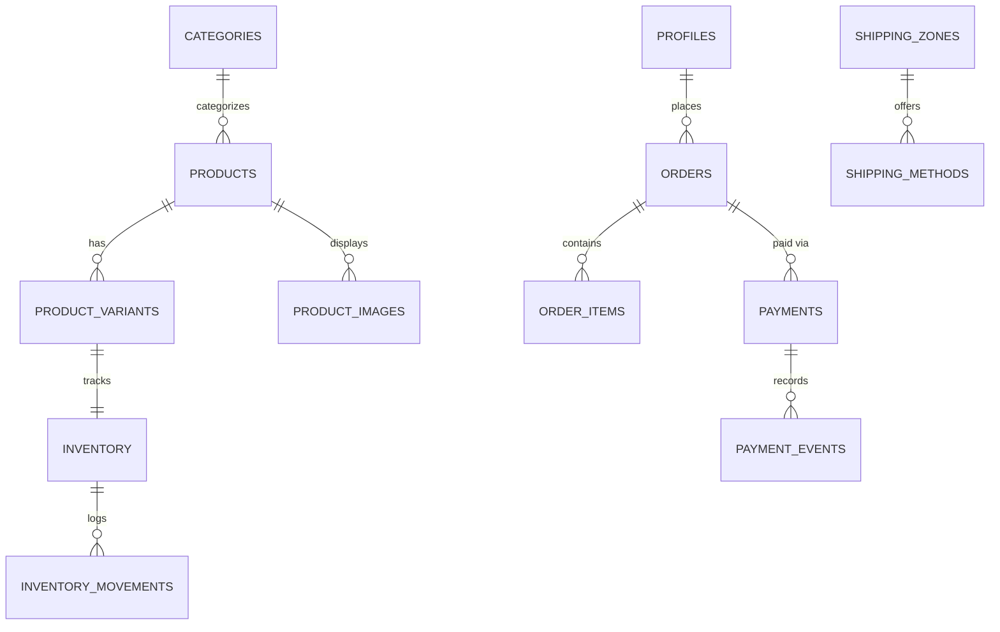

# HILAARA Store — Single-Vendor Somali Fashion E-Commerce Platform

[](https://app.netlify.com/sites/hilaara-store/deploys)
[](https://opensource.org/licenses/MIT)
[](https://prettier.io)

> **HILAARA** is a premium, single-vendor fashion e-commerce platform purpose-built for the Somali market. Developed as a full-stack engineering capstone and CodeAlpha Full Stack Development portfolio submission.

---

## 1. Project Overview

- **Brand:** HILAARA (*Somali for elegance, grace, and refined radiance*)
- **Market:** Somalia exclusively (Mogadishu, Hargeisa, Garowe, Bosaso, Kismayo, and regional hubs)
- **Business Model:** Single-vendor direct-to-consumer (D2C) brand. Not a marketplace (no 3rd-party sellers, no seller dashboards, no multi-vendor splitting).
- **Product Scope:** Men's and women's contemporary & heritage fashion (Linen Caftans, Diracs, Guntiinos, Wool Safari Blazers, bespoke accessories).
- **Payment Ecosystem:** Ubiquitous Somali mobile wallets (Hormuud EVC Plus, Somtel eDahab, Telesom ZAAD) and Doorstep Mobile Money on Delivery.

---

## 2. Technology Stack & Architecture



### Frontend
- **Framework:** React 18 with Vite
- **Styling:** Tailwind CSS with custom editorial brand tokens (`warm-ivory: #F7F5EF`, `charcoal: #191A17`, `muted-olive: #777B62`, `soft-beige: #E8E2D8`)
- **Routing:** React Router v6 with route-level code splitting (`React.lazy()`)
- **Icons:** Lucide React
- **Animations:** Framer Motion (respects user's `prefers-reduced-motion`)

### Backend & Database
- **Database:** Supabase PostgreSQL with relational integrity, foreign keys, and indexes
- **Authentication:** Supabase Auth (GoTrue) with JWT session lifecycle, custom profile table, and role-based guards
- **Security:** PostgreSQL Row-Level Security (RLS) policies protecting customer data and restricting admin write procedures
- **Serverless:** Netlify Functions (`create-order.js`, `process-payment.js`, `imagekit-auth.js`) for trusted price verification, stock deduction, and secure signatures

### Media Delivery
- **CDN:** ImageKit for responsive image transformation, WebP delivery, and real-time cropping

---

## 3. Key Features

### 🛍️ Editorial Storefront
- **Responsive Navigation:** Announcement ticker, sticky header, mobile drawer menu, instant debounced search modal.
- **Editorial Homepage:** Curated collection gateways, featured hero sections, new arrivals carousel, brand story, and service guarantees.
- **Faceted Product Catalog:** Filter by category, gender, color, size, and price range with real-time stock status.
- **Product Detail Page (PDP):** Multi-angle gallery, size/color variant selectors, dynamic stock ceiling enforcement, and sizing guides.
- **Persistent Cart & Wishlist:** Dual persistence (`localStorage` for guests, synchronized to database upon login).

### 💳 Somali Mobile Money Payment Gateway
- **Dispatcher Architecture:** Adapter pattern supporting EVC Plus, eDahab, ZAAD, and Pay on Delivery.
- **Simulation Controller:** Dedicated demo simulation modal displaying realistic USSD push prompts (`*712*...#`) with 4 test scenarios:
  1. *Simulate Instant Approval* (generates synthetic USSD transaction code, e.g., `EVC-TX-492104`, marks order confirmed).
  2. *Simulate Insufficient Balance / Reject* (emulates wallet rejection without losing cart items).
  3. *Simulate USSD Timeout* (emulates 60-second carrier timeout).
  4. *Cancel Transaction*.
- **Doorstep Mobile Transfer:** Records `awaiting_delivery_payment` status for courier payment verification.

### 📦 Nationwide Somali Logistics
- Configured delivery coverage zones and transparent rates:
  - **Mogadishu Metropolitan:** Standard (1-2 days, $3.00) & Express Same-Day ($5.00)
  - **Somaliland Urban:** Hargeisa, Borama, Berbera (2-3 days, $7.00)
  - **Puntland Hubs:** Garowe, Bosaso (2-4 days, $8.00)
  - **Southern Centers:** Kismayo, Baidoa (3-5 days, $10.00)

### 🛡️ Administrative Command Center (`/admin`)
- **Dedicated Shell:** High-contrast dark navigation sidebar (`#141513`), breadcrumb navigation, and store online/maintenance toggle.
- **Live Analytics:** Zero fabricated metrics; dynamically computes Total Paid Revenue (`SUM(total_amount)` WHERE `payment_status = 'paid'`), total orders, and low-stock warnings.
- **Product CRUD:** Full catalog editor with pricing, flags (`is_published`, `is_featured`, `is_new_arrival`), and variant matrix builder.
- **Inventory Matrix:** Variant-level SKU stock tracking with increment/decrement adjustment modal and reason audit logs.
- **Order Management:** Lifecycle status transitions (`pending` → `confirmed` → `processing` → `out_for_delivery` → `delivered`), courier note appender, and mobile money payment verification.
- **Tamper-Evident Audit Trail:** Chronological log tracking every administrative change, price update, and stock movement.

---

## 4. Database Schema Overview



---

## 5. Getting Started Locally

### Prerequisites
- Node.js 18+
- npm or pnpm
- Git

### Installation

```bash
# 1. Clone repository
git clone https://github.com/Abdalle13/CodeAlpha_E-commerceplatform.git
cd CodeAlpha_E-commerceplatform

# 2. Install dependencies
npm install

# 3. Configure environment variables (Optional - platform operates in resilient demo mode out of the box)
cp .env.example .env.local

# 4. Start local development server
npm run dev
```

Visit `http://localhost:5173` in your browser.

---

## 6. Running Tests

The test suite runs with Vitest and React Testing Library:

```bash
# Run unit & integration test suite
npm test

# Run tests in UI watch mode
npx vitest --ui

# Verify production build
npm run build
```

---

## 7. Netlify Deployment

The project is pre-configured for Netlify with root `netlify.toml` and single-page routing redirects:

1. Push your repository to GitHub.
2. Link the repository in the Netlify Dashboard.
3. Configure build settings:
   - **Build Command:** `npm run build`
   - **Publish Directory:** `dist`
   - **Functions Directory:** `netlify/functions`
4. Set production environment variables:
   - `VITE_SUPABASE_URL`
   - `VITE_SUPABASE_ANON_KEY`
   - `SUPABASE_SERVICE_ROLE_KEY`
   - `IMAGEKIT_PUBLIC_KEY`
   - `IMAGEKIT_PRIVATE_KEY`
   - `IMAGEKIT_URL_ENDPOINT`

---

## 8. License & Authorship

Developed with pride for the **CodeAlpha Full Stack Development Internship**.
All brand identities, custom SVG marks, and typography design systems created exclusively for **HILAARA**.
Licensed under the [MIT License](LICENSE).
