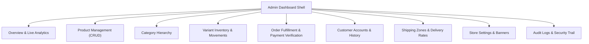

# HILAARA Store - Admin Dashboard Architecture and Specification

## 1. Administrative Vision and Operational Standard

The HILAARA Admin Dashboard is an enterprise-grade retail command center directly linked to Supabase PostgreSQL. It is designed to manage day-to-day fashion store operations with speed, clarity, and uncompromising data integrity.

### Strict Data Integrity Guarantees
- Zero Fabricated Metrics: Every key performance indicator (KPI), chart series, table row, and notification badge is computed dynamically from real database records.
- Honest Empty States: If the store has zero orders, total revenue displays `$0.00` and charts render an intuitive empty state inviting the admin to process test transactions.
- Exact Revenue Calculation: The `Total Paid Revenue` metric aggregates only orders where `payment_status = 'paid'`. Pending and unpaid orders are explicitly separated into independent operational queues.
- Real Operational Controls: Every button, toggle, dropdown filter, and modal triggers actual persistent database updates with toast feedback. There are no dead controls.

---

## 2. Admin Visual Identity and Layout System

The dashboard employs a dedicated professional interface distinct from the consumer storefront:

- Dark Navigation Sidebar: Deep charcoal background (`#141513`) with subtle borders, featuring the white HILAARA monogram and clear navigation hierarchy.
- Refined Header Bar: Breadcrumb trail, current store status toggle, administrative profile menu, and live notification trigger.
- Content Canvas: Clean Warm Ivory canvas (`#F7F5EF`) with structured white card surfaces, crisp 1px borders in soft beige, and clear typography.
- Mobile Responsive Shell: Responsive collapsible drawer with touch-friendly controls for on-the-go store management on smartphones and tablets.

---

## 3. Core Administrative Modules

---

## 4. Module Details and Functional Specifications

### 4.1 Overview and Analytics
- KPI Metric Cards:
  - Total Paid Revenue: `SUM(total_amount)` WHERE `payment_status = 'paid'`.
  - Total Orders: `COUNT(*)` from `orders`.
  - Pending Orders: `COUNT(*)` WHERE `order_status = 'pending'`.
  - Low Stock Alerts: `COUNT(*)` from `inventory` WHERE `quantity <= low_stock_threshold`.
  - Catalog Size: Total published vs draft products.
- Real-Time Revenue Chart: Daily or monthly aggregated revenue query based on real `orders.created_at` timestamps.
- Order Status Distribution: Visual breakdown showing current distribution across lifecycle stages (pending, processing, out for delivery, delivered).
- Recent Activity Feed: Live list of latest customer orders with quick links to fulfill.

---

### 4.2 Product Management (Full CRUD)
- Product Catalog Table: Searchable by title or SKU, filterable by category, gender, and publication status.
- Add / Edit Product Modal & View:
  - Basic Info: Title, slug (auto-generated or manual), description, gender classification, category selector.
  - Pricing: Base price, discount price (with real-time margin/discount percentage calculation).
  - Flags: `is_published`, `is_featured`, `is_new_arrival`.
  - Media Management: Integrated ImageKit upload manager supporting drag-and-drop, primary image designation, and reordering.
  - Variant Builder: Add and manage multiple size (XS to XXL) and color (name and hex) combinations with unique SKUs.
- Delete and Archive: Safe deletion with referential integrity checks (products referenced in historical orders are archived rather than hard-deleted).

---

### 4.3 Inventory Matrix and Movement Logging
- Real-Time Stock View: Tabular breakdown showing stock levels per variant SKU.
- Stock Adjustments: Quick inline increment/decrement with required reason notes (e.g., "Received shipment", "Damaged item written off").
- Movement Audit Trail: Immutable historical log in `inventory_movements` displaying timestamp, admin user, previous quantity, delta, new quantity, and reason.
- Low-Stock Thresholds: Configurable per-variant alerts triggering visual warning tags.

---

### 4.4 Order Fulfillment and Payment Verification
- Master Orders Table: Filterable by order status, payment status, delivery zone, and date range.
- Order Detail Modal / Page:
  - Customer contact details, delivery address, and special instructions.
  - Itemized purchase snapshot with thumbnails, sizes, colors, and snapshot prices.
  - Order Status Controller: Select next valid state (e.g., Move from `processing` to `out_for_delivery`).
  - Mobile Money Payment Verification: Authorize Pay on Delivery or manually verify mobile money transfer reference codes.
  - Tracking Note Appender: Add public customer-facing delivery notes or private staff notes.
- Printable Shipping Slip / Invoice: Clean layout formatted for thermal receipt or A4 printing.

---

### 4.5 Customer Relationship Management
- Customer List: View registered customers, registered dates, and total order counts.
- Customer Detail View: Summary of customer contact information, saved addresses, and complete chronological purchase history.

---

### 4.6 Shipping and Logistics Settings
- Zone Management: Add, edit, or disable geographical delivery zones (e.g., Mogadishu, Hargeisa).
- Method Management: Configure specific delivery options (Same-Day, Express, Standard) with real fees and estimated delivery turnaround times.

---

### 4.7 Store Settings and Merchandising
- Store Identity: Contact phone numbers, support WhatsApp lines, official email, and physical store address.
- Announcement Bar Text: Toggle and edit active promotional or operational notice.
- Featured Collection Banners: Select which categories or collections are highlighted on the storefront homepage.

---

### 4.8 Audit Logs and Security Trail
- Comprehensive Security Log: Displays who performed what action, when, and from what IP address.
- Tracked Events: Product creation/editing/deletion, price updates, manual stock adjustments, order cancellations, and payment approvals.
