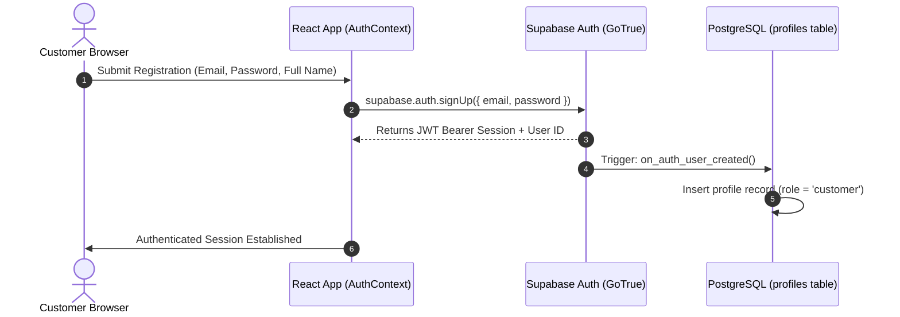

# HILAARA Store - Authentication and Security Architecture

## 1. Security Overview and Guiding Principles

Security is an essential requirement across every layer of HILAARA. Because e-commerce transactions involve customer personal information, delivery addresses, and financial verification, the system implements defense-in-depth:

- Never trust the client: Product pricing, inventory availability, order totals, and role claims submitted from the browser are treated as untrusted until validated on the database or trusted serverless boundary.
- Strict Row-Level Security: Every database table containing tenant, order, or administrative data has PostgreSQL RLS enabled with explicit `USING` and `WITH CHECK` clauses.
- Zero Secret Leakage: The Supabase `service_role` key and ImageKit private keys are strictly quarantined in backend serverless environments and never referenced in client bundles.
- Privilege Escalation Prevention: The `role` column on customer profiles is protected by database triggers that reject client-initiated role mutations.

---

## 2. Authentication Flow and Session Management

Authentication is managed via Supabase Auth leveraging industry-standard JSON Web Tokens (JWT).

### 2.1 Customer Registration and Login Flow



### 2.2 Session Persistence and Token Refresh
- Access Tokens: Short-lived JWTs (typically 1 hour) containing user ID and claims.
- Refresh Tokens: Securely stored in browser local storage and refreshed transparently by the Supabase JavaScript SDK.
- Session Termination: Immediate revocation of local tokens and disconnection of Supabase Realtime subscriptions upon logout.

### 2.3 Password Reset Protocol
- Password Recovery Request: Customer submits registered email via `/forgot-password`.
- One-Time Secure Link: Supabase Auth delivers an encrypted reset link pointing to the configured Netlify site URL `/reset-password`.
- Token Verification: Customer navigates to reset form, inputs new password, and Supabase updates the hashed credential.

---

## 3. Role-Based Access Control (RBAC)

HILAARA defines two explicit roles:
1. `customer`: Default role for all public registrants. Can manage personal cart, wishlist, saved addresses, and view personal orders.
2. `admin`: Store owner role. Has unrestricted read and write privileges across catalog, inventory, order processing, delivery settings, and audit logs.

### 3.1 Role Verification and Security Definer Helper

To avoid recursive RLS evaluations, an optimized PostgreSQL helper function executes with elevated security:

```sql
CREATE OR REPLACE FUNCTION public.is_admin()
RETURNS BOOLEAN
LANGUAGE sql
SECURITY DEFINER
SET search_path = public
STABLE
AS $$
  SELECT EXISTS (
    SELECT 1 FROM profiles
    WHERE id = auth.uid()
    AND role = 'admin'
  );
$$;
```

### 3.2 Anti-Privilege Escalation Trigger
Customers cannot elevate their own role to `admin`. Even if a malicious user issues a `supabase.from('profiles').update({ role: 'admin' })` request, the following trigger blocks the modification:

```sql
CREATE OR REPLACE FUNCTION public.protect_profile_role()
RETURNS TRIGGER
LANGUAGE plpgsql
AS $$
BEGIN
  -- Only existing admins can alter the role column
  IF NEW.role IS DISTINCT FROM OLD.role THEN
    IF NOT public.is_admin() THEN
      RAISE EXCEPTION 'Access denied: You cannot alter account roles.';
    END IF;
  END IF;
  RETURN NEW;
END;
$$;

CREATE TRIGGER trg_protect_profile_role
BEFORE UPDATE ON public.profiles
FOR EACH ROW
EXECUTE FUNCTION public.protect_profile_role();
```

---

## 4. Row-Level Security (RLS) Policy Matrix

| Database Table | Select Policy | Insert Policy | Update Policy | Delete Policy |
| :--- | :--- | :--- | :--- | :--- |
| `profiles` | `auth.uid() = id OR is_admin()` | `auth.uid() = id` | `auth.uid() = id OR is_admin()` | `is_admin()` |
| `addresses` | `auth.uid() = user_id OR is_admin()` | `auth.uid() = user_id` | `auth.uid() = user_id` | `auth.uid() = user_id` |
| `categories` | `is_active = true OR is_admin()` | `is_admin()` | `is_admin()` | `is_admin()` |
| `products` | `is_published = true OR is_admin()` | `is_admin()` | `is_admin()` | `is_admin()` |
| `product_images` | `true (Public read)` | `is_admin()` | `is_admin()` | `is_admin()` |
| `product_variants` | `is_active = true OR is_admin()` | `is_admin()` | `is_admin()` | `is_admin()` |
| `inventory` | `is_admin()` | `is_admin()` | `is_admin()` | `is_admin()` |
| `inventory_movements` | `is_admin()` | `is_admin()` | `No one (Append-only)` | `No one (Immutable)` |
| `carts` | `auth.uid() = user_id` | `auth.uid() = user_id` | `auth.uid() = user_id` | `auth.uid() = user_id` |
| `cart_items` | `EXISTS(SELECT 1 FROM carts WHERE id = cart_items.cart_id AND user_id = auth.uid())` | `Cart owner only` | `Cart owner only` | `Cart owner only` |
| `wishlists` | `auth.uid() = user_id` | `auth.uid() = user_id` | `auth.uid() = user_id` | `auth.uid() = user_id` |
| `wishlist_items` | `Wishlist owner only` | `Wishlist owner only` | `Wishlist owner only` | `Wishlist owner only` |
| `shipping_zones` | `is_active = true OR is_admin()` | `is_admin()` | `is_admin()` | `is_admin()` |
| `shipping_methods` | `is_active = true OR is_admin()` | `is_admin()` | `is_admin()` | `is_admin()` |
| `orders` | `auth.uid() = user_id OR is_admin()` | `auth.uid() = user_id` | `is_admin()` | `No one (Auditable)` |
| `order_items` | `Order owner OR is_admin()` | `Order owner during checkout` | `No one (Immutable)` | `No one (Immutable)` |
| `payments` | `EXISTS(SELECT 1 FROM orders WHERE id = payments.order_id AND (user_id = auth.uid() OR is_admin()))` | `Order owner during checkout` | `is_admin()` | `No one (Immutable)` |
| `order_status_history` | `Order owner OR is_admin()` | `is_admin()` | `No one (Append-only)` | `No one (Immutable)` |
| `store_settings` | `true (Public read)` | `is_admin()` | `is_admin()` | `is_admin()` |
| `audit_logs` | `is_admin()` | `is_admin() OR System` | `No one (Immutable)` | `No one (Immutable)` |

---

## 5. Client Route Protection

Frontend routing guards prevent unauthorized access to sensitive views:

- `ProtectedRoute`: Verifies that an active Supabase user session exists. If unauthenticated, the user is redirected to `/login` with an encoded `returnUrl` state parameter.
- `AdminRoute`: Verifies both active authentication and that `profile.role === 'admin'`. If the user is a standard customer, they are redirected to `/account/overview` with an unauthorized access toast notification.
- Route Guard Fallback: While the initial session is being evaluated from storage, an un-styled skeleton prevents content flashes.

---

## 6. Secrets Management and Edge Security

### 6.1 Permitted Public Environment Variables
The client bundle may only include non-sensitive connection parameters:
- `VITE_SUPABASE_URL`: Public Supabase API gateway URL.
- `VITE_SUPABASE_ANON_KEY`: Public anonymous client key (strictly limited by RLS).
- `VITE_IMAGEKIT_URL_ENDPOINT`: Public media CDN base URL.
- `VITE_IMAGEKIT_PUBLIC_KEY`: Public identifier for client-side widget binding.

### 6.2 Quarantined Private Environment Variables
The following keys are stored exclusively in Netlify production environment variables and accessed only by serverless functions:
- `SUPABASE_SERVICE_ROLE_KEY`: Administrative bypass key.
- `IMAGEKIT_PRIVATE_KEY`: Secret HMAC key used to generate signed upload tokens.
