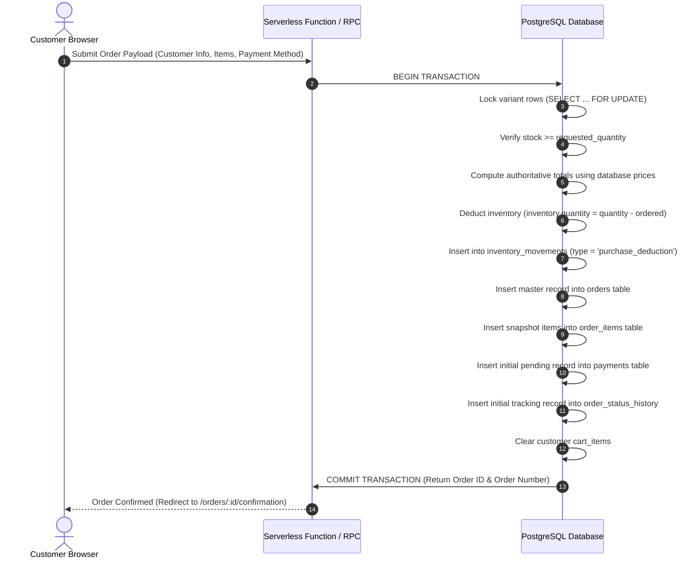

# HILAARA Store - Cart and Checkout Specification

## 1. Shopping Cart Architecture

The HILAARA shopping cart handles variant selection, quantity manipulation, and state persistence across customer sessions.

### 1.1 Dual Persistence Strategy
- Unauthenticated Guests: Cart items are maintained in browser `localStorage`.
- Authenticated Customers: Upon user login, items stored in `localStorage` are merged into the persistent `carts` and `cart_items` database tables. Future cart actions synchronize with PostgreSQL via Supabase client calls.

### 1.2 Cart Item Data Structure
Each cart line item requires unambiguous variant resolution:
- `variant_id`: UUID pointing to `product_variants.id`.
- `product_id`: UUID pointing to `products.id`.
- `name`: Product title.
- `sku`: Variant SKU.
- `size`: Selected size (e.g., "M", "L").
- `color_name`: Selected color description.
- `color_hex`: Color swatch value.
- `image_url`: Thumbnail image from `product_images`.
- `price`: Client-side reference price (subject to server re-verification).
- `quantity`: Number of units desired (validated against current stock).

---

## 2. Cart Slide-Over Drawer and Dedicated Page

Shoppers can access their cart through an interactive slide-over drawer on any page or through the full `/cart` page.

### Features
- Real-time Subtotal: Dynamic calculation of item totals.
- Quantity Controls: Plus and minus buttons with automatic stock ceiling limits.
- Item Removal: Fast deletion with optimistic UI updates and undo toasts.
- Free Delivery Progress Bar: Optional threshold indicator showing how close the cart is to free delivery incentives.
- Direct Checkout Progression: Immediate transition to checkout with validation checks.

---

## 3. Server-Side Price and Stock Verification

Client-side prices and stock levels can become stale or be maliciously tampered with. Under no circumstances does HILAARA trust client-provided totals when creating an order.

### Verification Flow Prior to Order Placement
1. Fetch authoritative `base_price`, `discount_price`, and `price_override` directly from PostgreSQL for each variant.
2. Confirm that current physical inventory (`inventory.quantity`) is greater than or equal to the requested quantity.
3. If an item is out of stock or price has changed, abort checkout and notify the customer with an explicit discrepancy notice.
4. Compute official order `subtotal`, fetch official `delivery_fee` for the selected shipping method, apply valid discount coupons, and calculate `total_amount`.

---

## 4. Checkout Process and User Interface

The checkout flow at `/checkout` is engineered as a single-page, multi-step accordion or split column layout to minimize abandonment on mobile devices.

### 4.1 Step 1: Customer Contact Information
- Full Name: Required.
- Phone Number: Required, formatted for Somali mobile networks (+252 61... or +252 63...).
- Email Address: Required for order confirmation and account tracking.

### 4.2 Step 2: Delivery Details
- City: Selector populated from active `shipping_zones` (e.g., Mogadishu, Hargeisa, Garowe).
- District / Area: Text field specifying local neighborhood (e.g., Hodan, Waberi, 26 June).
- Detailed Street Address: House, building, or landmark details.
- Delivery Instructions: Optional delivery notes (e.g., "Call upon arrival at gate").

### 4.3 Step 3: Delivery Method Selection
- Populated dynamically based on chosen city/zone.
- Displays shipping method name, fee, and estimated delivery window (e.g., "Same-Day Mogadishu Delivery - $2.00").

### 4.4 Step 4: Payment Method Selection
Customers select from supported mobile payment options:
- EVC Plus (Hormuud Mobile Money)
- eDahab (Telesom / Somtel Mobile Money)
- ZAAD (Telesom Mobile Money)
- Pay on Delivery (Settled via mobile money when the courier arrives)

### 4.5 Step 5: Order Review and Submission
- Itemized summary table with thumbnail, title, variant details, quantity, and verified prices.
- Transparent price breakdown: Subtotal, Delivery Fee, Discount (if applied), Grand Total.
- Clear order terms and confirmation trigger.

---

## 5. Duplicate Submission Prevention

To prevent double-billing and duplicate database entries:
- Submit Button State: The "Complete Order" button is immediately disabled upon click and displays an animated spinner with the text "Securing your order...".
- Idempotency Key: A client-generated unique UUID (`idempotency_key`) accompanies the submission payload.
- Page Unload Protection: A `beforeunload` listener warns the customer if an order transaction is currently in flight.

---

## 6. Atomic Checkout Stored Procedure

Order creation, price calculation, variant snapshotting, and inventory deduction are executed inside a single PostgreSQL transaction function:

