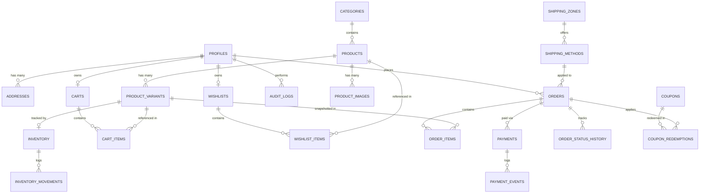

# HILAARA Store - Database Schema Specification

## 1. Relational Architecture and Design Principles

The HILAARA database schema is built upon PostgreSQL 15 on Supabase. It adheres to strict third normal form (3NF) standards with intentional, immutable denormalization snapshots on historical order records to guarantee commercial audibility.

### Core Principles
- Exact Monetary Representation: All prices, fees, discounts, and totals are stored as `NUMERIC(10,2)` to eliminate floating-point rounding errors.
- Single Currency Configuration: All monetary amounts are recorded in United States Dollars (`USD`).
- Historical Immutability: When an order is placed, a full snapshot of the product title, SKU, variant size, variant color, and unit price is copied to `order_items`. Subsequent edits to catalog products or prices never alter historical orders.
- Concurrency Protection: Inventory counts are updated using atomic SQL statements and advisory locks to prevent overselling or race conditions.
- Soft Delete Support: Sensitive entities like products and categories support soft-deletion or active flags (`is_active = false`) so historical references remain intact.

---

## 2. Entity Relationship Diagram (ERD)



---

## 3. Detailed Table Specifications

### 3.1 Authentication and Customer Profiles

#### `profiles`
Represents customer and administrator accounts linked to `auth.users`.
- `id` (UUID, Primary Key, Foreign Key to `auth.users.id` ON DELETE CASCADE)
- `email` (TEXT, NOT NULL, UNIQUE)
- `full_name` (TEXT, NOT NULL)
- `phone` (TEXT, NULL)
- `role` (TEXT, NOT NULL DEFAULT 'customer', CHECK (role IN ('customer', 'admin')))
- `created_at` (TIMESTAMPTZ, NOT NULL DEFAULT NOW())
- `updated_at` (TIMESTAMPTZ, NOT NULL DEFAULT NOW())

#### `addresses`
Saved delivery addresses for customers.
- `id` (UUID, Primary Key DEFAULT gen_random_uuid())
- `user_id` (UUID, NOT NULL, REFERENCES `profiles(id)` ON DELETE CASCADE)
- `full_name` (TEXT, NOT NULL)
- `phone` (TEXT, NOT NULL)
- `city` (TEXT, NOT NULL)
- `district` (TEXT, NOT NULL)
- `street_address` (TEXT, NOT NULL)
- `delivery_instructions` (TEXT, NULL)
- `is_default` (BOOLEAN, NOT NULL DEFAULT false)
- `created_at` (TIMESTAMPTZ, NOT NULL DEFAULT NOW())
- `updated_at` (TIMESTAMPTZ, NOT NULL DEFAULT NOW())

---

### 3.2 Catalog and Inventory

#### `categories`
Product classification hierarchy (e.g., Men's Shirts, Women's Dresses).
- `id` (UUID, Primary Key DEFAULT gen_random_uuid())
- `name` (TEXT, NOT NULL)
- `slug` (TEXT, NOT NULL UNIQUE)
- `description` (TEXT, NULL)
- `gender` (TEXT, NOT NULL, CHECK (gender IN ('men', 'women', 'unisex')))
- `display_order` (INTEGER, NOT NULL DEFAULT 0)
- `is_active` (BOOLEAN, NOT NULL DEFAULT true)
- `created_at` (TIMESTAMPTZ, NOT NULL DEFAULT NOW())
- `updated_at` (TIMESTAMPTZ, NOT NULL DEFAULT NOW())

#### `products`
Master product definitions.
- `id` (UUID, Primary Key DEFAULT gen_random_uuid())
- `category_id` (UUID, REFERENCES `categories(id)` ON DELETE SET NULL)
- `name` (TEXT, NOT NULL)
- `slug` (TEXT, NOT NULL UNIQUE)
- `description` (TEXT, NOT NULL)
- `gender` (TEXT, NOT NULL, CHECK (gender IN ('men', 'women', 'unisex')))
- `base_price` (NUMERIC(10,2), NOT NULL, CHECK (base_price >= 0))
- `discount_price` (NUMERIC(10,2), NULL, CHECK (discount_price IS NULL OR discount_price < base_price))
- `is_published` (BOOLEAN, NOT NULL DEFAULT false)
- `is_featured` (BOOLEAN, NOT NULL DEFAULT false)
- `is_new_arrival` (BOOLEAN, NOT NULL DEFAULT true)
- `created_at` (TIMESTAMPTZ, NOT NULL DEFAULT NOW())
- `updated_at` (TIMESTAMPTZ, NOT NULL DEFAULT NOW())

#### `product_images`
Product imagery managed through ImageKit.
- `id` (UUID, Primary Key DEFAULT gen_random_uuid())
- `product_id` (UUID, NOT NULL, REFERENCES `products(id)` ON DELETE CASCADE)
- `imagekit_file_id` (TEXT, NOT NULL)
- `imagekit_url` (TEXT, NOT NULL)
- `imagekit_path` (TEXT, NOT NULL)
- `alt_text` (TEXT, NULL)
- `display_order` (INTEGER, NOT NULL DEFAULT 0)
- `is_primary` (BOOLEAN, NOT NULL DEFAULT false)
- `created_at` (TIMESTAMPTZ, NOT NULL DEFAULT NOW())

#### `product_variants`
Specific garment size and color combinations.
- `id` (UUID, Primary Key DEFAULT gen_random_uuid())
- `product_id` (UUID, NOT NULL, REFERENCES `products(id)` ON DELETE CASCADE)
- `sku` (TEXT, NOT NULL UNIQUE)
- `size` (TEXT, NOT NULL)
- `color_name` (TEXT, NOT NULL)
- `color_hex` (TEXT, NOT NULL)
- `price_override` (NUMERIC(10,2), NULL, CHECK (price_override IS NULL OR price_override >= 0))
- `is_active` (BOOLEAN, NOT NULL DEFAULT true)
- `created_at` (TIMESTAMPTZ, NOT NULL DEFAULT NOW())
- `updated_at` (TIMESTAMPTZ, NOT NULL DEFAULT NOW())

#### `inventory`
Real-time physical stock counts per variant.
- `id` (UUID, Primary Key DEFAULT gen_random_uuid())
- `variant_id` (UUID, NOT NULL UNIQUE, REFERENCES `product_variants(id)` ON DELETE CASCADE)
- `quantity` (INTEGER, NOT NULL DEFAULT 0, CHECK (quantity >= 0))
- `low_stock_threshold` (INTEGER, NOT NULL DEFAULT 5)
- `updated_at` (TIMESTAMPTZ, NOT NULL DEFAULT NOW())

#### `inventory_movements`
Audit log of all physical stock additions, reductions, and cancellations.
- `id` (UUID, Primary Key DEFAULT gen_random_uuid())
- `inventory_id` (UUID, NOT NULL, REFERENCES `inventory(id)` ON DELETE CASCADE)
- `quantity_change` (INTEGER, NOT NULL)
- `previous_quantity` (INTEGER, NOT NULL)
- `new_quantity` (INTEGER, NOT NULL)
- `movement_type` (TEXT, NOT NULL, CHECK (movement_type IN ('purchase_deduction', 'cancellation_restock', 'manual_adjustment', 'initial_stock')))
- `reference_id` (TEXT, NULL)
- `performed_by` (UUID, NULL, REFERENCES `profiles(id)` ON DELETE SET NULL)
- `notes` (TEXT, NULL)
- `created_at` (TIMESTAMPTZ, NOT NULL DEFAULT NOW())

---

### 3.3 Shopping Cart and Wishlist

#### `carts`
Shopping session container per customer.
- `id` (UUID, Primary Key DEFAULT gen_random_uuid())
- `user_id` (UUID, NOT NULL UNIQUE, REFERENCES `profiles(id)` ON DELETE CASCADE)
- `created_at` (TIMESTAMPTZ, NOT NULL DEFAULT NOW())
- `updated_at` (TIMESTAMPTZ, NOT NULL DEFAULT NOW())

#### `cart_items`
Garment variants selected by customer.
- `id` (UUID, Primary Key DEFAULT gen_random_uuid())
- `cart_id` (UUID, NOT NULL, REFERENCES `carts(id)` ON DELETE CASCADE)
- `variant_id` (UUID, NOT NULL, REFERENCES `product_variants(id)` ON DELETE CASCADE)
- `quantity` (INTEGER, NOT NULL DEFAULT 1, CHECK (quantity > 0))
- `created_at` (TIMESTAMPTZ, NOT NULL DEFAULT NOW())
- `updated_at` (TIMESTAMPTZ, NOT NULL DEFAULT NOW())
- CONSTRAINT `unique_cart_variant` UNIQUE (cart_id, variant_id)

#### `wishlists`
Customer wishlist container.
- `id` (UUID, Primary Key DEFAULT gen_random_uuid())
- `user_id` (UUID, NOT NULL UNIQUE, REFERENCES `profiles(id)` ON DELETE CASCADE)
- `created_at` (TIMESTAMPTZ, NOT NULL DEFAULT NOW())

#### `wishlist_items`
- `id` (UUID, Primary Key DEFAULT gen_random_uuid())
- `wishlist_id` (UUID, NOT NULL, REFERENCES `wishlists(id)` ON DELETE CASCADE)
- `product_id` (UUID, NOT NULL, REFERENCES `products(id)` ON DELETE CASCADE)
- `created_at` (TIMESTAMPTZ, NOT NULL DEFAULT NOW())
- CONSTRAINT `unique_wishlist_product` UNIQUE (wishlist_id, product_id)

---

### 3.4 Shipping, Orders, and Payments

#### `shipping_zones`
Geographic delivery regions within Somalia.
- `id` (UUID, Primary Key DEFAULT gen_random_uuid())
- `name` (TEXT, NOT NULL UNIQUE)
- `description` (TEXT, NULL)
- `is_active` (BOOLEAN, NOT NULL DEFAULT true)
- `created_at` (TIMESTAMPTZ, NOT NULL DEFAULT NOW())

#### `shipping_methods`
Delivery options and fees tied to zones.
- `id` (UUID, Primary Key DEFAULT gen_random_uuid())
- `zone_id` (UUID, NOT NULL, REFERENCES `shipping_zones(id)` ON DELETE CASCADE)
- `name` (TEXT, NOT NULL)
- `fee` (NUMERIC(10,2), NOT NULL DEFAULT 0.00, CHECK (fee >= 0))
- `estimated_delivery_time` (TEXT, NOT NULL)
- `is_active` (BOOLEAN, NOT NULL DEFAULT true)
- `created_at` (TIMESTAMPTZ, NOT NULL DEFAULT NOW())

#### `orders`
Master order record.
- `id` (UUID, Primary Key DEFAULT gen_random_uuid())
- `order_number` (TEXT, NOT NULL UNIQUE)
- `user_id` (UUID, NOT NULL, REFERENCES `profiles(id)` ON DELETE RESTRICT)
- `shipping_method_id` (UUID, NULL, REFERENCES `shipping_methods(id)` ON DELETE SET NULL)
- `customer_name` (TEXT, NOT NULL)
- `customer_phone` (TEXT, NOT NULL)
- `customer_email` (TEXT, NOT NULL)
- `shipping_city` (TEXT, NOT NULL)
- `shipping_district` (TEXT, NOT NULL)
- `shipping_address` (TEXT, NOT NULL)
- `delivery_instructions` (TEXT, NULL)
- `subtotal` (NUMERIC(10,2), NOT NULL, CHECK (subtotal >= 0))
- `delivery_fee` (NUMERIC(10,2), NOT NULL DEFAULT 0.00, CHECK (delivery_fee >= 0))
- `discount_amount` (NUMERIC(10,2), NOT NULL DEFAULT 0.00, CHECK (discount_amount >= 0))
- `total_amount` (NUMERIC(10,2), NOT NULL, CHECK (total_amount >= 0))
- `currency` (TEXT, NOT NULL DEFAULT 'USD')
- `order_status` (TEXT, NOT NULL DEFAULT 'pending', CHECK (order_status IN ('pending', 'confirmed', 'processing', 'ready_for_delivery', 'out_for_delivery', 'delivered', 'cancelled')))
- `payment_status` (TEXT, NOT NULL DEFAULT 'pending', CHECK (payment_status IN ('pending', 'awaiting_delivery_payment', 'paid', 'failed', 'cancelled', 'refunded')))
- `payment_method` (TEXT, NOT NULL, CHECK (payment_method IN ('evc_plus', 'edahab', 'zaad', 'pay_on_delivery')))
- `notes` (TEXT, NULL)
- `created_at` (TIMESTAMPTZ, NOT NULL DEFAULT NOW())
- `updated_at` (TIMESTAMPTZ, NOT NULL DEFAULT NOW())

#### `order_items`
Immutable purchase-time snapshot of ordered variants.
- `id` (UUID, Primary Key DEFAULT gen_random_uuid())
- `order_id` (UUID, NOT NULL, REFERENCES `orders(id)` ON DELETE CASCADE)
- `variant_id` (UUID, NULL, REFERENCES `product_variants(id)` ON DELETE SET NULL)
- `product_id` (UUID, NULL, REFERENCES `products(id)` ON DELETE SET NULL)
- `product_name` (TEXT, NOT NULL)
- `variant_sku` (TEXT, NOT NULL)
- `variant_size` (TEXT, NOT NULL)
- `variant_color_name` (TEXT, NOT NULL)
- `unit_price` (NUMERIC(10,2), NOT NULL, CHECK (unit_price >= 0))
- `quantity` (INTEGER, NOT NULL, CHECK (quantity > 0))
- `total_price` (NUMERIC(10,2), NOT NULL, CHECK (total_price >= 0))
- `created_at` (TIMESTAMPTZ, NOT NULL DEFAULT NOW())

#### `payments`
Financial transaction records.
- `id` (UUID, Primary Key DEFAULT gen_random_uuid())
- `order_id` (UUID, NOT NULL, REFERENCES `orders(id)` ON DELETE CASCADE)
- `payment_method` (TEXT, NOT NULL)
- `amount` (NUMERIC(10,2), NOT NULL, CHECK (amount >= 0))
- `currency` (TEXT, NOT NULL DEFAULT 'USD')
- `status` (TEXT, NOT NULL, CHECK (status IN ('pending', 'awaiting_delivery_payment', 'paid', 'failed', 'cancelled', 'refunded')))
- `transaction_reference` (TEXT, NULL)
- `payer_phone` (TEXT, NULL)
- `provider_metadata` (JSONB, NOT NULL DEFAULT '{}'::jsonb)
- `confirmed_by` (UUID, NULL, REFERENCES `profiles(id)` ON DELETE SET NULL)
- `confirmed_at` (TIMESTAMPTZ, NULL)
- `created_at` (TIMESTAMPTZ, NOT NULL DEFAULT NOW())
- `updated_at` (TIMESTAMPTZ, NOT NULL DEFAULT NOW())

#### `payment_events`
Audit log of payment lifecycle events (webhooks, callbacks, manual admin approvals).
- `id` (UUID, Primary Key DEFAULT gen_random_uuid())
- `payment_id` (UUID, NOT NULL, REFERENCES `payments(id)` ON DELETE CASCADE)
- `event_type` (TEXT, NOT NULL)
- `payload` (JSONB, NOT NULL DEFAULT '{}'::jsonb)
- `created_at` (TIMESTAMPTZ, NOT NULL DEFAULT NOW())

#### `order_status_history`
Chronological audit log of fulfillment stages visible to customers.
- `id` (UUID, Primary Key DEFAULT gen_random_uuid())
- `order_id` (UUID, NOT NULL, REFERENCES `orders(id)` ON DELETE CASCADE)
- `status` (TEXT, NOT NULL)
- `notes` (TEXT, NULL)
- `created_by` (UUID, NULL, REFERENCES `profiles(id)` ON DELETE SET NULL)
- `created_at` (TIMESTAMPTZ, NOT NULL DEFAULT NOW())

---

### 3.5 Marketing, Settings, and Auditing

#### `coupons`
Promotional discount codes.
- `id` (UUID, Primary Key DEFAULT gen_random_uuid())
- `code` (TEXT, NOT NULL UNIQUE)
- `discount_type` (TEXT, NOT NULL, CHECK (discount_type IN ('percentage', 'fixed_amount')))
- `discount_value` (NUMERIC(10,2), NOT NULL, CHECK (discount_value > 0))
- `min_order_amount` (NUMERIC(10,2), NOT NULL DEFAULT 0.00)
- `max_uses` (INTEGER, NULL)
- `current_uses` (INTEGER, NOT NULL DEFAULT 0)
- `starts_at` (TIMESTAMPTZ, NOT NULL DEFAULT NOW())
- `expires_at` (TIMESTAMPTZ, NULL)
- `is_active` (BOOLEAN, NOT NULL DEFAULT true)
- `created_at` (TIMESTAMPTZ, NOT NULL DEFAULT NOW())

#### `coupon_redemptions`
- `id` (UUID, Primary Key DEFAULT gen_random_uuid())
- `coupon_id` (UUID, NOT NULL, REFERENCES `coupons(id)` ON DELETE CASCADE)
- `order_id` (UUID, NOT NULL, REFERENCES `orders(id)` ON DELETE CASCADE)
- `user_id` (UUID, NOT NULL, REFERENCES `profiles(id)` ON DELETE CASCADE)
- `discount_applied` (NUMERIC(10,2), NOT NULL)
- `redeemed_at` (TIMESTAMPTZ, NOT NULL DEFAULT NOW())

#### `store_settings`
Global operational parameters configured by the administrator.
- `key` (TEXT, Primary Key)
- `value` (JSONB, NOT NULL)
- `description` (TEXT, NULL)
- `updated_by` (UUID, NULL, REFERENCES `profiles(id)` ON DELETE SET NULL)
- `updated_at` (TIMESTAMPTZ, NOT NULL DEFAULT NOW())

#### `audit_logs`
System-wide administrative security and activity log.
- `id` (UUID, Primary Key DEFAULT gen_random_uuid())
- `user_id` (UUID, NULL, REFERENCES `profiles(id)` ON DELETE SET NULL)
- `action` (TEXT, NOT NULL)
- `entity_type` (TEXT, NOT NULL)
- `entity_id` (TEXT, NULL)
- `old_values` (JSONB, NULL)
- `new_values` (JSONB, NULL)
- `ip_address` (TEXT, NULL)
- `created_at` (TIMESTAMPTZ, NOT NULL DEFAULT NOW())

---

## 4. Performance Indexes

```sql
CREATE INDEX idx_products_category ON products(category_id);
CREATE INDEX idx_products_published ON products(is_published);
CREATE INDEX idx_products_gender ON products(gender);
CREATE INDEX idx_product_variants_product ON product_variants(product_id);
CREATE INDEX idx_inventory_variant ON inventory(variant_id);
CREATE INDEX idx_orders_user ON orders(user_id);
CREATE INDEX idx_orders_status ON orders(order_status);
CREATE INDEX idx_orders_payment_status ON orders(payment_status);
CREATE INDEX idx_order_items_order ON order_items(order_id);
CREATE INDEX idx_payments_order ON payments(order_id);
CREATE INDEX idx_audit_logs_user ON audit_logs(user_id);
CREATE INDEX idx_audit_logs_created_at ON audit_logs(created_at DESC);
```
