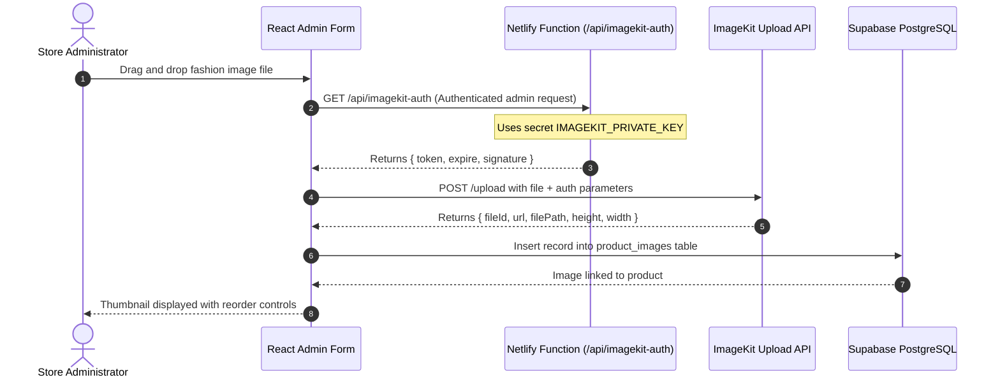

# HILAARA Store - ImageKit Integration and Media Pipeline

## 1. Media Architecture Overview

High-quality fashion photography is central to the HILAARA retail experience. Visual media is processed, stored, and distributed globally using ImageKit.io.

The architecture provides:
- Automated WebP/AVIF format negotiation for bandwidth conservation.
- Real-time image transformations and smart cropping.
- Dynamic responsive `srcset` generation for smartphones and high-density retina displays.
- Strict security boundaries preventing the exposure of ImageKit private API keys.

---

## 2. Security Architecture and Upload Flow

Direct client uploads to ImageKit are authenticated via an ephemeral HMAC signature generated on demand by a trusted Netlify serverless function.



### 2.1 Serverless Authentication Handler
The Netlify function located at `netlify/functions/imagekit-auth.js` securely signs upload requests:

```javascript
const crypto = require('crypto');

exports.handler = async (event, context) => {
  // Verify CORS and authorization
  const privateKey = process.env.IMAGEKIT_PRIVATE_KEY;
  if (!privateKey) {
    return {
      statusCode: 500,
      body: JSON.stringify({ error: 'ImageKit private key missing from server environment.' })
    };
  }

  const token = event.queryStringParameters?.token || crypto.randomUUID();
  const expire = event.queryStringParameters?.expire || (Math.floor(Date.now() / 1000) + 2400).toString();
  const signature = crypto
    .createHmac('sha1', privateKey)
    .update(token + expire)
    .digest('hex');

  return {
    statusCode: 200,
    headers: {
      'Content-Type': 'application/json',
      'Access-Control-Allow-Origin': '*'
    },
    body: JSON.stringify({ token, expire, signature })
  };
};
```

---

## 3. Transformation Standards and Aspect Ratios

To maintain visual cohesion across the storefront, all garment photography conforms to predetermined aspect ratios and optimization rules:

### 3.1 Transformation Presets

| Image Purpose | Aspect Ratio | Target Dimensions | ImageKit Transformation Query |
| :--- | :--- | :--- | :--- |
| Product Catalog Card | 3:4 Vertical | 750 x 1000 px | `tr=w-750,h-1000,cm-pad_resize,bg-F7F5EF,q-85,f-auto` |
| Product Detail Hero | 3:4 Vertical | 1200 x 1600 px | `tr=w-1200,h-1600,cm-pad_resize,bg-F7F5EF,q-90,f-auto` |
| Cart & Checkout Thumb | 1:1 Square | 200 x 200 px | `tr=w-200,h-200,fo-auto,q-80,f-auto` |
| Editorial Hero Banner | 16:9 Landscape | 1920 x 1080 px | `tr=w-1920,h-1080,fo-custom,q-85,f-auto` |
| Collection Card | 4:5 Portrait | 800 x 1000 px | `tr=w-800,h-1000,fo-auto,q-85,f-auto` |

### 3.2 URL Construction Utility
A client helper function builds transformed URLs safely:

```javascript
export function buildImageUrl(pathOrUrl, transformations = {}) {
  if (!pathOrUrl) return '/brand/placeholder-garment.svg';
  if (pathOrUrl.startsWith('http') && !pathOrUrl.includes('ik.imagekit.io')) {
    return pathOrUrl; // External fallback
  }

  const endpoint = import.meta.env.VITE_IMAGEKIT_URL_ENDPOINT?.replace(/\/$/, '') || 'https://ik.imagekit.io/hilaara';
  const cleanPath = pathOrUrl.replace(/^https:\/\/ik\.imagekit\.io\/[^/]+\//, '').replace(/^\//, '');

  const trParts = [];
  if (transformations.width) trParts.push(`w-${transformations.width}`);
  if (transformations.height) trParts.push(`h-${transformations.height}`);
  if (transformations.cropMode) trParts.push(`cm-${transformations.cropMode}`);
  if (transformations.quality) trParts.push(`q-${transformations.quality}`);
  trParts.push('f-auto');

  const trString = trParts.length > 0 ? `tr=${trParts.join(',')}` : '';
  return `${endpoint}/${trString ? `${trString}/` : ''}${cleanPath}`;
}
```

---

## 4. Administrative Media Controls

Through the admin product management interface, store operators can:
- Batch Upload: Upload multiple high-resolution photos per garment in a single action.
- Primary Image Toggle: Designate which photograph serves as the default catalog card image.
- Secondary Hover Selection: Designate an alternate image that smoothly reveals when shoppers hover over the card.
- Reorder Gallery: Reorder gallery photos via drag-and-drop or position buttons.
- Deletion: Delete unneeded image assets from both PostgreSQL and ImageKit storage.

---

## 5. Environment Variables and Graceful Fallbacks

### Required Variables
- `VITE_IMAGEKIT_URL_ENDPOINT`: Public CDN base URL (e.g., `https://ik.imagekit.io/hilaarastore`).
- `VITE_IMAGEKIT_PUBLIC_KEY`: Public key required for client-side upload widgets.
- `IMAGEKIT_PRIVATE_KEY`: Private secret key set in Netlify Functions runtime.

### Graceful Fallback Strategy
If ImageKit environment variables are not populated during early local development:
- The system gracefully falls back to local curated fashion assets located in `public/brand/` or neutral SVG garment wireframes.
- The UI never breaks or displays broken image icons.
- Warning notices in the admin media manager clearly remind the developer to configure ImageKit credentials.
