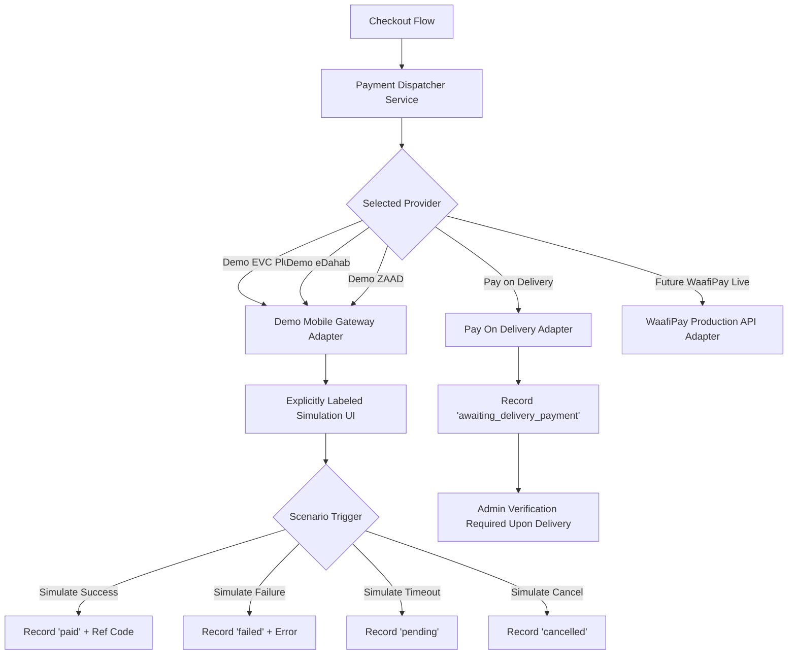

# HILAARA Store - Payment Integration and Gateway Specification

## 1. Somali Mobile Money Context

The retail economy in urban Somalia is nearly 100% cashless, driven by ubiquitous telecommunications mobile money ecosystems:

- EVC Plus: Hormuud Telecom (predominant across South and Central Somalia, including Mogadishu).
- eDahab: Telesom and Somtel networks (widespread across Somaliland, Puntland, and national hubs).
- ZAAD: Telesom (predominant in Somaliland and western commercial centers).
- Pay on Delivery: In the Somali context, "pay on delivery" does not imply paper fiat currency; rather, customers complete a direct mobile money USSD transfer to the courier's business merchant code upon physical receipt.

---

## 2. WaafiPay Integration Investigation

### 2.1 Provider Overview
WaafiPay (developed by Hormuud, Salaam Somali Bank, and partners) is the leading unified payment gateway in Somalia. It provides REST APIs supporting EVC Plus, ZAAD, eDahab, and card payments.

### 2.2 Production vs Sandbox Accessibility
- API Endpoint (Production): `https://api.waafipay.net/asm`
- Required Authentication Parameters:
  - `merchantId`: Registered business merchant code.
  - `apiKey`: Private API secret key.
  - `apiUserId`: Authorized backend user identifier.
- Sandbox Access Analysis: WaafiPay sandbox access requires an authorized corporate merchant agreement, direct banking KYC vetting with Salaam Somali Bank or Telesom, and manual IP address allowlisting by the gateway NOC team. Public self-serve developer sandbox registration is not openly accessible without official merchant underwriting.

### 2.3 Integration Decision and Policy
In accordance with engineering guidelines:
- No live production credentials exist in this environment.
- We do not fabricate or pretend that live banking credentials exist.
- The platform implements a complete, modular, and explicitly labeled **Simulation and Demo Payment Gateway** alongside an extensible interface architecture that maps directly to the WaafiPay API contract.
- Customers and evaluators are clearly informed that transactions in this mode are simulated demonstration payments.

---

## 3. Modular Payment Architecture

The payment system follows the Adapter Pattern (`PaymentGatewayInterface`), allowing seamless transition from simulation to live WaafiPay credentials without refactoring checkout components.

---

## 4. Payment Data Structure and State Machine

### 4.1 Payment Lifecycle States

| State | Description | Next Permitted States |
| :--- | :--- | :--- |
| `pending` | Payment session initiated; waiting for customer approval. | `paid`, `failed`, `cancelled` |
| `awaiting_delivery_payment` | Order dispatched with Pay on Delivery. Awaiting mobile transfer at doorstep. | `paid`, `cancelled` |
| `paid` | Transaction verified and funds confirmed in merchant account. | `refunded` |
| `failed` | Mobile money transaction rejected, insufficient funds, or USSD timeout. | `pending` (retry) |
| `cancelled` | Customer or administrator terminated transaction before completion. | None |
| `refunded` | Monies returned to customer mobile wallet following order cancellation. | None |

### 4.2 Payment Record Fields
- `id`: UUID.
- `order_id`: Associated order reference.
- `payment_method`: One of `evc_plus`, `edahab`, `zaad`, `pay_on_delivery`.
- `amount`: Verified decimal amount.
- `currency`: 'USD'.
- `status`: Active payment state.
- `transaction_reference`: Unique USSD transaction code (e.g., `EVC-TX-984214`).
- `payer_phone`: Phone number initiating the payment.
- `provider_metadata`: JSON object containing provider response codes, timestamps, and simulation flags.
- `confirmed_by`: Administrator UUID (for Pay on Delivery verifications).
- `confirmed_at`: Timestamp of physical payment confirmation.

---

## 5. Explicitly Labeled Demo Payment Experience

When a customer selects EVC Plus, eDahab, or ZAAD, the checkout displays a dedicated **Simulation Payment Controller**:

1. Prominent Visual Indicator:
   - Amber warning banner reading: "Demonstration Payment Mode Active. No real money will be deducted from your mobile account."
2. Interactive Scenario Controls:
   - "Simulate Instant Approval": Resolves payment as `paid`, generates synthetic USSD transaction reference, and marks order as `confirmed`.
   - "Simulate Insufficient Balance / Reject": Resolves payment as `failed`, restores cart, and prompts customer to re-attempt or switch payment methods.
   - "Simulate USSD Timeout": Resolves payment as `pending` to test customer waiting and manual polling states.
   - "Cancel Transaction": Terminates the checkout attempt.
3. Realistic Simulation Feedback:
   - Emulates mobile USSD push notification prompts typical of Somali mobile money apps.

---

## 6. Pay on Delivery Fulfillment and Audit Protocol

When a customer selects "Pay on Delivery":
1. The checkout sets order `payment_status` to `awaiting_delivery_payment`.
2. The order is processed and packaged for courier dispatch.
3. Upon physical arrival, the customer sends mobile money to the store's designated Hormuud or Telesom merchant number.
4. The store administrator verifies funds in the merchant statement and marks the payment as `paid` in the HILAARA Admin Dashboard.
5. An immutable record is created in `audit_logs` capturing `admin_id`, `payment_id`, and `timestamp`.
