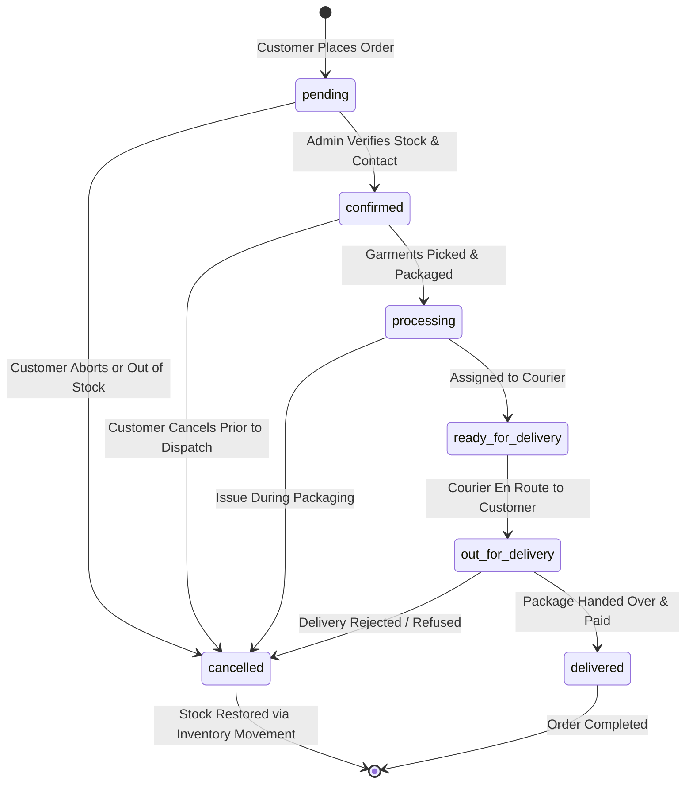

# HILAARA Store - Shipping and Order Management

## 1. Logistics and Fulfillment Model

Delivery operations for HILAARA operate strictly within Somalia. Logistics rely on direct store courier dispatch in major metropolitan centers and trusted regional inter-city logistics partners for outer territories.

The system does not fabricate fictional third-party delivery API integrations (such as DHL or FedEx webhooks). Instead, it provides an authentic, comprehensive fulfillment management workflow operated directly through the HILAARA Admin Dashboard.

---

## 2. Dynamic Shipping Zones and Methods

The store administrator configures delivery zones and rates in the database without code changes:

### 2.1 Standard Shipping Zones
- Mogadishu Metropolitan (Zone 1): Covers Hodan, Waberi, Hamar Weyne, Bondhere, Yaqshid, Wadajir, and surrounding districts.
- Somaliland Urban (Zone 2): Covers Hargeisa, Borama, Berbera, and Burao.
- Puntland Hubs (Zone 3): Covers Garowe, Bosaso, and Galkayo.
- Southern Centers (Zone 4): Covers Kismayo and Baidoa.

### 2.2 Configurable Delivery Parameters
For each shipping method, the administrator controls:
- Name: (e.g., "Mogadishu Express Same-Day", "Regional Courier Transfer").
- Delivery Fee: Decimal USD amount (e.g., $2.00, $5.00, or $0.00 for promotions).
- Estimated Delivery Window: Human-readable delivery expectations (e.g., "Within 4 hours", "1 to 2 business days").
- Active Status: Instant toggle to temporarily suspend delivery to specific zones during severe weather or logistics disruption.

---

## 3. Order Lifecycle and State Transitions

An order moves through distinct stages from customer checkout to final delivery.

### 3.1 Order Status Definitions

| Status | Meaning | Permitted Next Actions |
| :--- | :--- | :--- |
| `pending` | Order submitted; awaiting initial store review and phone confirmation. | `confirmed`, `cancelled` |
| `confirmed` | Store team verified customer availability and delivery address. | `processing`, `cancelled` |
| `processing` | Garments retrieved from stockroom and packaged in HILAARA packaging. | `ready_for_delivery`, `cancelled` |
| `ready_for_delivery` | Package sealed with invoice; waiting for courier pickup. | `out_for_delivery`, `cancelled` |
| `out_for_delivery` | Dedicated courier is actively traveling to customer address. | `delivered`, `cancelled` |
| `delivered` | Package delivered; payment confirmed and recorded. | None (Completed) |
| `cancelled` | Order voided; physical inventory automatically returned to stock. | None (Terminated) |

---

## 4. Inventory Stock Restoration Rules

When an order enters the `cancelled` state:
1. The database checks whether inventory was previously deducted during checkout.
2. An automated function iterates through each line in `order_items` and increments `inventory.quantity` by the corresponding count.
3. An audit record is created in `inventory_movements` with `movement_type = 'cancellation_restock'`, referencing the cancelled order number.
4. Orders that have reached `delivered` status cannot be marked `cancelled` without an explicit return/refund authorization.

---

## 5. Customer Self-Service Tracking Experience

Customers can inspect their order progress in real time via `/account/orders/:orderNumber`:

- Visual Timeline Progress Tracker: Interactive step indicator highlighting completed stages (Order Placed -> Confirmed -> Packing -> Out for Delivery -> Delivered).
- Transparent Courier Notes: Explanations from the delivery team (e.g., "Courier assigned: Ahmed - Contact: +252 61 555 1234").
- Full Itemized Invoice: Snapshot of ordered items, selected sizes and colors, delivery fee, and payment method.
- Quick Assistance Action: Direct link to WhatsApp / phone support pre-populated with the specific order number.
