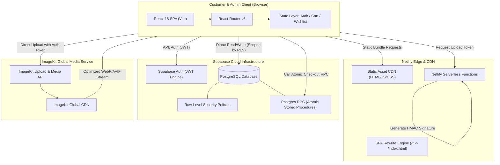

# HILAARA Store - Technology Stack and System Architecture

## 1. Architectural Philosophy and Design Principles

HILAARA is designed as a high-performance Single Page Application (SPA) backed by a robust Backend-as-a-Service (BaaS) and edge functions infrastructure. The architecture follows strict separation of concerns:

- Direct Client-to-Database Read Access: High-speed, cached queries directly to Supabase PostgreSQL governed by strict Postgres Row-Level Security (RLS) policies.
- Trusted Server-Side Boundaries: Critical operations including price verification, inventory decrements during order creation, and ImageKit authentication parameters run inside trusted server-side code (Netlify Functions or Supabase PostgreSQL security definer functions).
- Zero Mock Policy: All UI components consume real persistent schemas, handling genuine loading, empty, and populated states gracefully.
- Mobile Performance First: Aggressive code-splitting, route-level lazy loading, vector iconography, and responsive ImageKit image transforms ensure sub-second interaction times on standard 3G/4G cellular networks.

---

## 2. Technology Stack Specification

### 2.1 Client Layer
- Framework: React 18 (using functional components and modern hooks).
- Build Tool: Vite (configured for rapid HMR, optimized ESM bundling, and chunk splitting).
- Language: JavaScript (ESNext with modern syntax and modular architecture).
- Routing: React Router v6 (declarative browser routing with route-level lazy loading and protected route guards).
- Styling: Tailwind CSS (customized with HILAARA design tokens and responsive breakpoints).
- Iconography: Lucide React (clean, lightweight stroke-based SVG icons).
- Animation and Micro-interactions: Framer Motion (purposeful, hardware-accelerated transitions with reduced-motion support).
- State Management: Lightweight React Context + Custom Hooks for cart, authentication session, wishlist, and notification toasts.

### 2.2 Backend and Database Layer
- Database Engine: Supabase PostgreSQL 15+.
- Authentication: Supabase Auth (Email and password authentication with encrypted JWT bearer sessions).
- Access Control: PostgreSQL Row-Level Security (RLS) enforcing customer isolation and strict administrative privileges.
- Data Integrity: Check constraints, foreign keys, cascade protections, and database triggers for timestamp management and audit trails.
- Atomic Transactions: PostgreSQL stored procedures (`SECURITY DEFINER` functions) for concurrency-safe stock deduction and order placement.

### 2.3 Media and Asset Management
- Storage and CDN: ImageKit.io for media processing and global CDN delivery.
- Security: Server-side signature generation via Netlify Function (`imagekit-auth`) preventing unauthorized media tampering or credential leakage.
- Transformations: Dynamic query parameters for DPR scaling, auto-formatting (WebP/AVIF), and thumbnail generation.

### 2.4 Hosting and Edge Infrastructure
- Platform: Netlify.
- Edge Routing: Root `netlify.toml` configuring single-page application fallback rewrite (`/* /index.html 200`), caching headers for static assets, and security headers (CSP, X-Frame-Options, X-Content-Type-Options).
- Serverless Functions: Netlify Functions (Node.js runtime) located in `netlify/functions/` for trusted server-side endpoints.

---

## 3. High-Level System Architecture Diagram



---

## 4. Client Directory and Component Architecture

```text
hilaara-store/
├── docs/                      # 17 complete project specification documents
├── netlify/
│   └── functions/             # Trusted server-side serverless functions
│       ├── imagekit-auth.js   # Secure signature generator for media uploads
│       └── create-order.js    # Trusted server-side order calculation & stock validation
├── public/
│   ├── brand/                 # SVG logos, monograms, favicons
│   └── _redirects             # Netlify SPA fallback rule
├── src/
│   ├── assets/                # Static local imagery and brand graphics
│   ├── components/
│   │   ├── admin/             # Admin layout, sidebar, tables, stat cards, product forms
│   │   ├── common/            # Buttons, inputs, modals, toasts, badges, skeletons
│   │   ├── feedback/          # Empty states, error boundaries, loading spinners
│   │   ├── layout/            # Storefront Navbar, Footer, AnnouncementBar, MobileMenu
│   │   ├── product/           # ProductCard, ProductGrid, ProductGallery, VariantSelector
│   │   └── cart/              # CartDrawer, CartItem, QuantitySelector, SummaryBox
│   ├── context/
│   │   ├── AuthContext.jsx    # Session management, user profile, role identification
│   │   ├── CartContext.jsx    # Persistent cart items, quantity manipulation, subtotal
│   │   ├── WishlistContext.jsx# Customer wishlist persistence
│   │   └── ToastContext.jsx   # Global notification dispatch system
│   ├── hooks/                 # Custom reusable hooks (useProducts, useOrders, useDebounce)
│   ├── lib/
│   │   ├── supabase.js        # Configured Supabase JavaScript client
│   │   └── imagekit.js        # ImageKit URL builders and helper utilities
│   ├── pages/
│   │   ├── storefront/        # Home, Shop, ProductDetail, Collections, Cart, Checkout
│   │   ├── account/           # Profile, Orders, OrderDetail, Wishlist, Addresses
│   │   ├── auth/              # Login, Register, ForgotPassword, ResetPassword
│   │   └── admin/             # Dashboard, Products, Categories, Inventory, Orders, Settings
│   ├── routes/                # ProtectedRoute, AdminRoute, AppRoutes definition
│   ├── services/              # API abstraction modules (productsService, ordersService, etc.)
│   ├── styles/                # Tailwind directives and custom animation styles
│   ├── utils/                 # Price formatters, date formatters, validation utilities
│   ├── App.jsx                # Root application component with context providers
│   └── main.jsx               # Application entry point
├── index.html                 # HTML shell with instant lightweight preloader
├── netlify.toml               # Netlify build, redirect, and function configuration
├── tailwind.config.js         # Custom palette, typography, and container tokens
└── vite.config.js             # Vite configuration with chunk splitting rules
```

---

## 5. Security and Data Flow Boundaries

### 5.1 Public Unauthenticated Flows
- Browsing published products, categories, collections, and delivery zones.
- ImageKit CDN media consumption.
- Adding items to a local browser session cart (persisted in localStorage).

### 5.2 Authenticated Customer Flows
- Customer registration, authentication, and profile updates.
- Server-synced persistent shopping cart and personal wishlist.
- Creation of shipping addresses and customer-owned order submissions.
- Viewing personal order history and tracking updates (RLS limits `user_id = auth.uid()`).

### 5.3 Administrative Flows
- All administrative requests require a verified `admin` role in the `profiles` table.
- Admin dashboard access is guarded on the frontend by `AdminRoute` and enforced on PostgreSQL by strict RLS policies (`auth.uid() IN (SELECT id FROM profiles WHERE role = 'admin')`).
- Critical administrative operations write directly to the `audit_logs` table via triggers or explicit operational functions.
